# Sub-1-V Current-Mode Bandgap Reference — Banba Topology in gpdk090

**Pre-layout, schematic-level analog IC design and Spectre verification** in **Cadence Virtuoso**, using **gpdk090 (90 nm)**. Nominal supply: **1.0 V**. Results are at the **NN (typical/TT) corner unless stated otherwise**. This repository contains no bandgap layout, parasitic extraction or post-layout simulation results.

The circuit generates approximately **0.5 V** from a **1.0 V** supply. At NN, it achieved **499.08 mV at 27 °C**, **29.68 ppm/°C** over **−40 to 125 °C**, **11.912 µA** supply current at **27 °C**, **57.4 dB** low-frequency PSRR and **71.8°** phase margin at **27 °C**. These are **pre-layout** simulation results, not silicon measurements. **Line regulation and FS-corner temperature coefficient did not meet their targets.**

## Why a current-mode bandgap?

A voltage reference needs to change as little as possible when temperature changes. Two effects in the PNP devices help:

- **CTAT:** a PNP's emitter–base voltage falls as temperature rises (approximately **−1.8 mV/K**).
- **PTAT:** the difference between PNP emitter–base voltages at different current densities rises with temperature. With a current-density ratio **N = 8**, this difference is approximately **53.8 mV at 27 °C**, increasing at approximately **+0.18 mV/K**.

By combining the falling and rising contributions in the right proportions, the temperature slopes mostly cancel.

A conventional voltage-summing bandgap produces a voltage near **1.25 V**, which does not fit under a **1.0 V** supply. The **Banba current-mode topology** instead turns the temperature-dependent voltages into currents through resistors, adds the currents and develops the output voltage across another resistor. This allows **Vref ≈ 0.5 V** at a **1.0 V** supply.

**Attribution:** the *topology* follows Banba's current-mode bandgap approach. **Device sizes, biasing and resistor values were redesigned and tuned for gpdk090**; this is not a reproduction of the original paper's component values.

## Architecture and operation

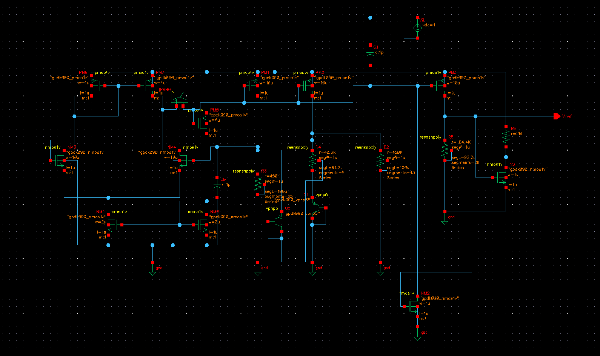

The final Virtuoso cell is `BGR/banba_bgr_real_poly`.

- **PNP and resistor branches:** Q0 and Q1 (with **N = 8**) generate the temperature-dependent terms. Equal **R2** and **R3** resistors support branch-current balancing.
- **NMOS-input OTA:** senses the two branches and adjusts the shared PMOS gate voltage until **Va ≈ Vb**. Its input **polarity is critical**: NM3 senses the `net14` (rs) branch; NM4 senses `net27` (Q0 branch). Reversing these connections makes the feedback positive.
- **PMOS mirror:** PM1, PM2 and PM3 share a gate line. PM3 copies the branch current to the output resistor **R0**. Matching the devices matters because the circuit assumes their currents are equal.
- **Startup:** the reference can otherwise remain in a zero-current state. When Vref is low, **RS** raises node **X**, turning on **NM2** to pull down the PMOS gate line and start current flow. Once Vref rises, **NS** pulls X low and NM2 switches off. The startup senses **Vref**, rather than Vb, because the normal hot Vb can be close to the low-current state.
- **On-chip OTA bias:** PM0 replaces the ideal OTA bias current source, so the final schematic does not rely on that ideal source.
- **Compensation:** C0 and C1 help stabilize the control loop; the final loop was checked with Spectre `stb`.

| Focused schematic views | |
|---|---|
| OTA | 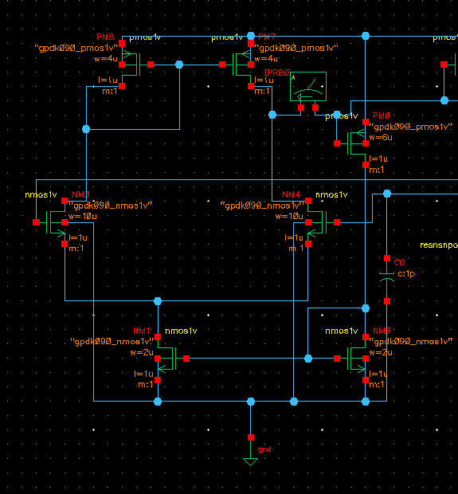 |
| Startup | 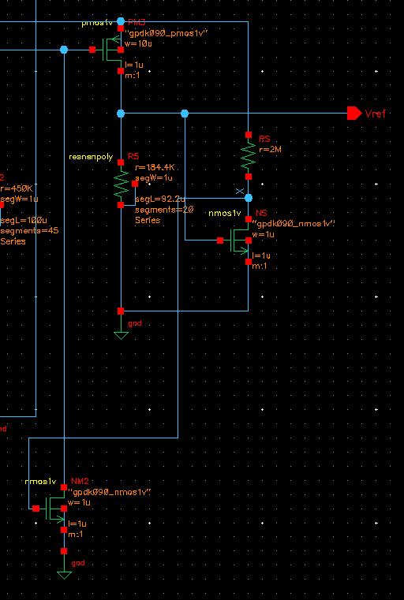 |
| Loop probe | 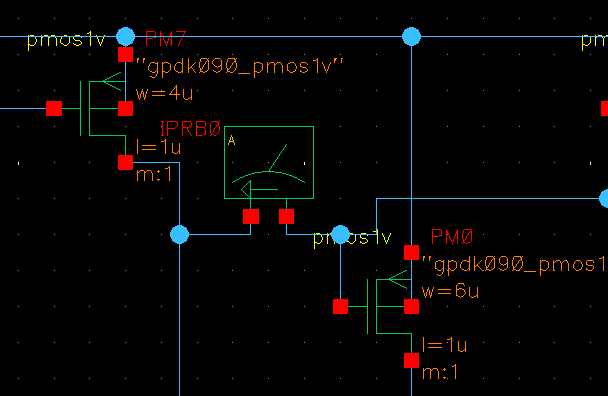 |

### Current balance and design equation

The two equal PMOS branch currents can be written as

$$
I_1 = I_{Q0} + \frac{V_a}{R_3},\qquad
I_2 = \frac{V_b}{R_2} + \frac{\Delta V_f}{r_s}.
$$

With **R2 = R3**, **Va ≈ Vb**, and **I1 ≈ I2**, the PNP current contribution satisfies **IQ0 ≈ ΔVf/rs**. PM3 copies the branch current through the output resistor, so

$$
V_{ref} = R_0\left(\frac{V_a}{R_3}+\frac{\Delta V_f}{r_s}\right),
\qquad \Delta V_f \approx V_T\ln(N).
$$

**Why these knobs matter:** **rs** adjusts the balance between the rising and falling temperature contributions, so it is tuned for low TC. **R0** scales the final output voltage toward **0.5 V**. Increasing all resistances while preserving ratios lowers the branch currents and therefore supply consumption; changing only R0 adjusts output scaling, but also changes PM3's drain voltage and can slightly affect TC.

### Final component values

| Block | Device(s) | Final value / size | Purpose |
|---|---|---|---|
| Current mirror | PM1, PM2, PM3 | `pmos1v`, W=10 µm, L=1 µm each | Equal branch / output currents |
| PNP pair | Q0, Q1 | `vpnp5`, m=1 and m=8 | Different current densities for PTAT |
| Branch resistors | R2, R3 | 450 kΩ each; 45 × 100 µm segments | Match branch resistances |
| PTAT tuning | R4 = rs | 40.6 kΩ; 5 × 81.2 µm segments | Set temperature compensation |
| Output | R5 = R0 | 184.4 kΩ; 20 × 92.2 µm segments | Set output voltage |
| OTA input | NM3, NM4 | `nmos1v`, W=10 µm, L=1 µm | Sense the branch-voltage difference |
| OTA load | PM7, PM8 | `pmos1v`, W=4 µm, L=1 µm | Mirror load |
| OTA tail bias | NM0, NM1 | W=2 µm, L=1 µm each | Set OTA operating current |
| OTA on-chip bias | PM0 | `pmos1v`, W=6 µm, L=1 µm | Replace ideal bias source |
| Compensation | C0, C1 | 1 pF each | Loop stability |
| Startup | NS, NM2 | `nmos1v`, W=1 µm, L=1 µm each | Start the reference, then switch off |
| Startup pull-up | RS | **Ideal** 2 MΩ | Raise startup node X when off |

R2, R3, R4 and R5 use **non-silicided poly** (`resnsnpoly`, **100 Ω/square**, W=**1 µm**) with series-connected segments. The resistor model's temperature-coefficient fields are **zero**; resistor temperature drift is **not modeled**. **RS remains an ideal resistor**, not a poly implementation.

## Pre-layout results versus targets

All values below are **Spectre schematic-level results**. Temperature, process and measurement conditions are specified in the detailed sections.

| Metric | Target | Pre-layout result | Status |
|---|---|---|---|
| Vref at 1.0 V, 27 °C, NN | ≈ 0.5 V | **499.08 mV** | **met** |
| TC, −40 to 125 °C, NN | < 50 ppm/°C | **29.68 ppm/°C** | **met** |
| TC across all five corners | < 50 ppm/°C | NN 29.68; FF 31.56; SF 36.18; SS 46.79; **FS 70.30 ppm/°C** | **not met** (FS) |
| Supply operating range | 0.9–1.1 V | Operates over **0.9–1.1 V** | **met** |
| Supply current, 27 °C, NN | < 20 µA | **11.8662–11.9607 µA** over 0.9–1.1 V | **met** |
| Line regulation, 0.9–1.1 V, 27 °C, NN | < 1 mV/V | **1.75 mV/V** | **not met** |
| PSRR, 27 °C, NN | > 40 dB (frequency unspecified) | **57.4 dB** at low frequency; > 40 dB only through **250.693 kHz** | **not met** beyond 250.693 kHz |
| Phase margin, 27 °C, NN | ≥ 60° | **71.8°** | **met** |
| Minimum supply for Vref within 1% of 1.0 V value | Report | **748.223 mV** | **reported** |
| Power-up startup | Successful startup | Successful tested startup cases; see below | **met** for tested cases |

See [detailed results table](docs/results_table.md) for operating points, corner readings and test conditions.

## Detailed simulation results

### Temperature sweep: typical corner

The **NN** DC sweep covers **−40 to 125 °C** in **1 °C** steps at **1.0 V**, with **`reltol=1e-6`** and **no nodesets**. The measured TC is **29.6769 ppm/°C**. Vref at **−40 / 27 / 125 °C** is **500.222 / 499.08 / 501.512 mV**. The plotted NN curve is a shallow valley.

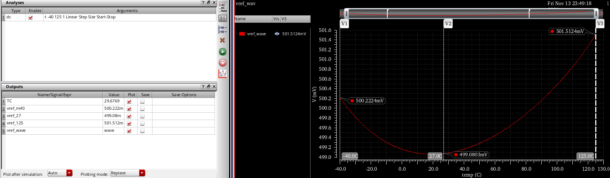

For comparison, the earlier **ideal-op-amp reference** achieved **15.70 ppm/°C**, but it used a VCVS op-amp and ideal resistors, rather than the final transistor-level implementation.

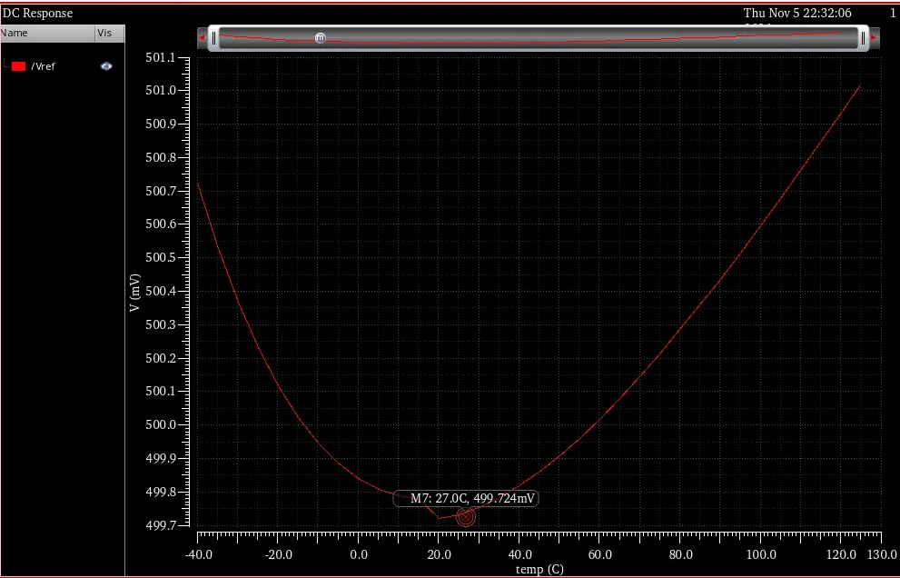

### Process-corner temperature coefficient

All process-corner TC sweeps used **1.0 V**, **−40 to 125 °C**, **1 °C** steps, **`reltol=1e-6`** and **no nodesets**. **FS does not meet the TC target.**

| Model section | Pre-layout TC (ppm/°C) | Target < 50 ppm/°C |
|---|---:|---|
| NN (typical) | 29.68 | met |
| FF | 31.56 | met |
| SF | 36.18 | met |
| SS | 46.79 | met |
| FS | **70.30** | **not met** |

| | |
|---|---|
| 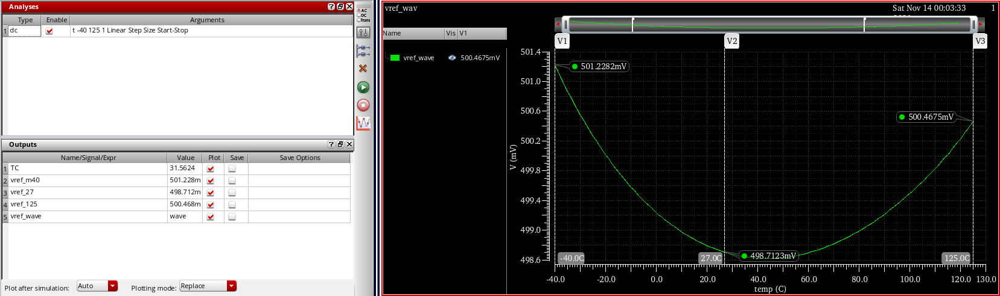 | 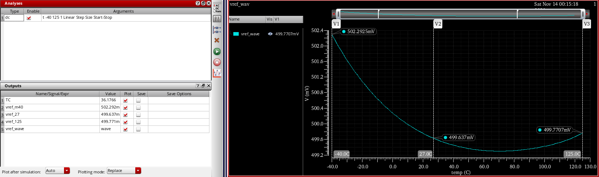 |
| 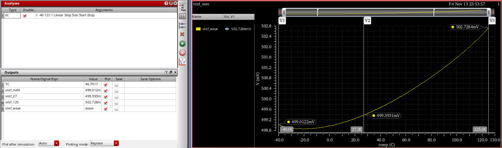 | 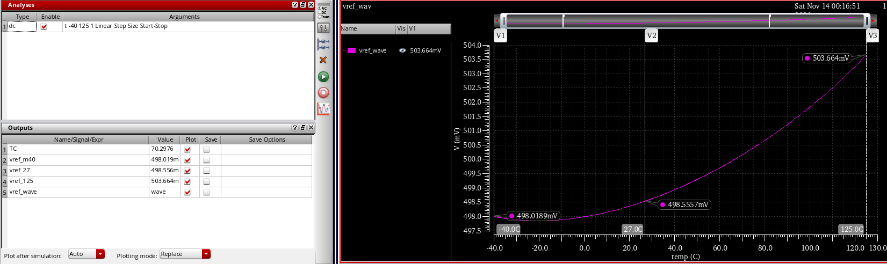 |

**Important corner-model detail:** NN is the typical device section. **SF and FS change the MOS skew while retaining typical resistor, capacitor, diode and bipolar models**. **SS and FF** also change the resistor, capacitor, diode and bipolar model sets. Thus, an FS result is not evidence of resistor or PNP corner drift.

At **125 °C**, the measured OTA input offset (`net27 − net14`) was **−629.245 µV in FS**, compared with **−287.635 µV in NN**. This correlates with the worse hot-corner TC, but **does not establish its cause**.

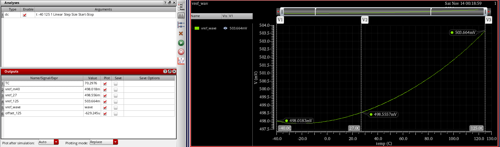

### Startup from a ramped supply

Without a startup circuit, the bandgap can stay in a low-current state. Startup was tested with the supply rising from **0 to 1 V over 100 µs**, a transient running to **500 µs**, and **no nodesets**. The documented measurement point is **450 µs**.

At **−40 °C and 125 °C**, startup was checked in **NN, SS, FF, SF and FS**. An **NN 27 °C** startup run was also recorded in the project data, but its screenshot is not included here. Every documented startup run settled to the corresponding DC solution; the startup node **X** remained at a few millivolts after startup.

| Corner | Cold startup | Hot startup |
|---|---|---|
| NN | 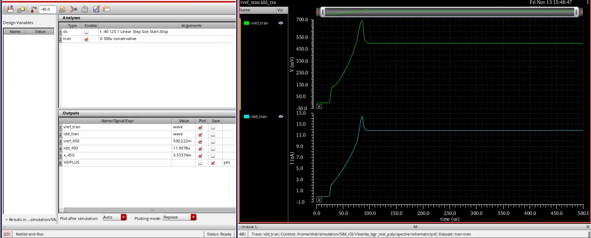 | 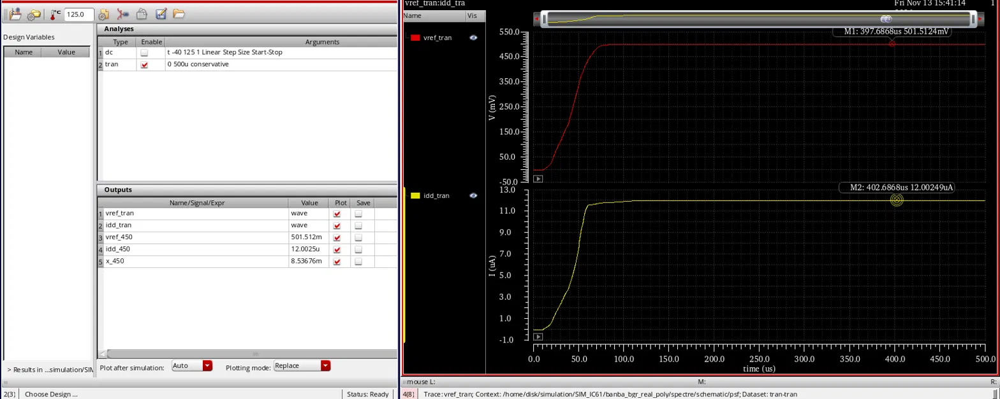 |
| SS | 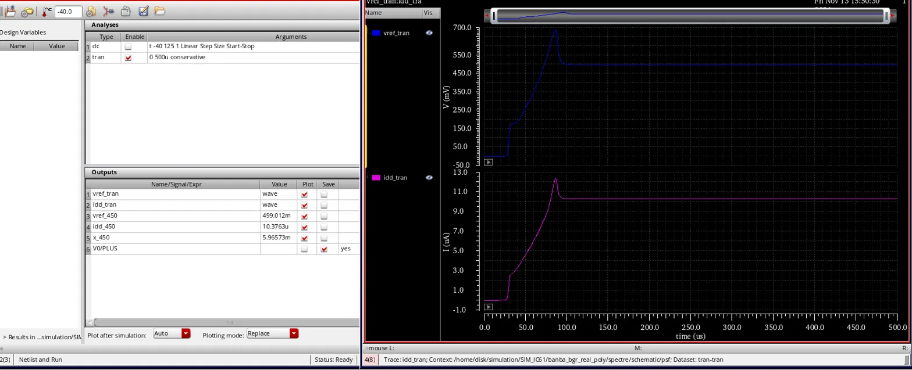 | 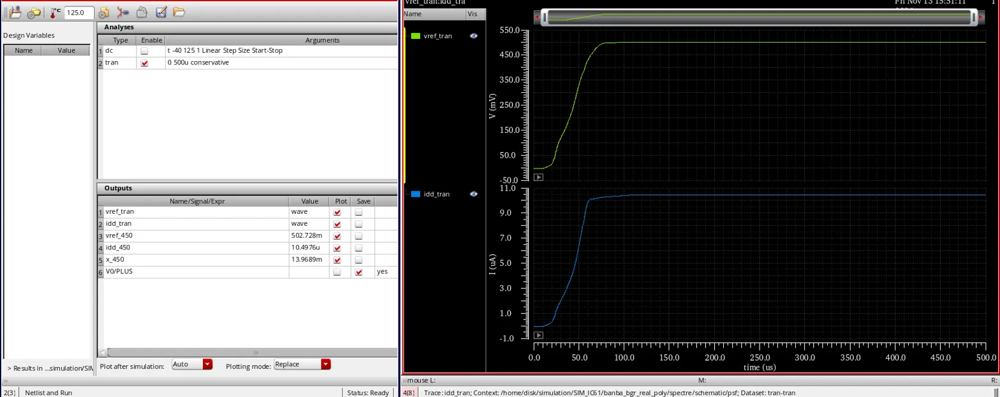 |
| FF | 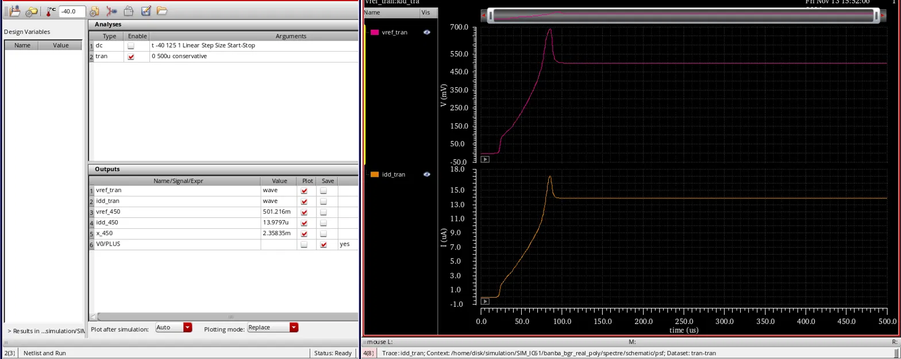 | 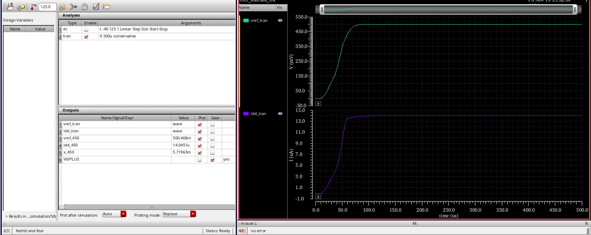 |
| SF | 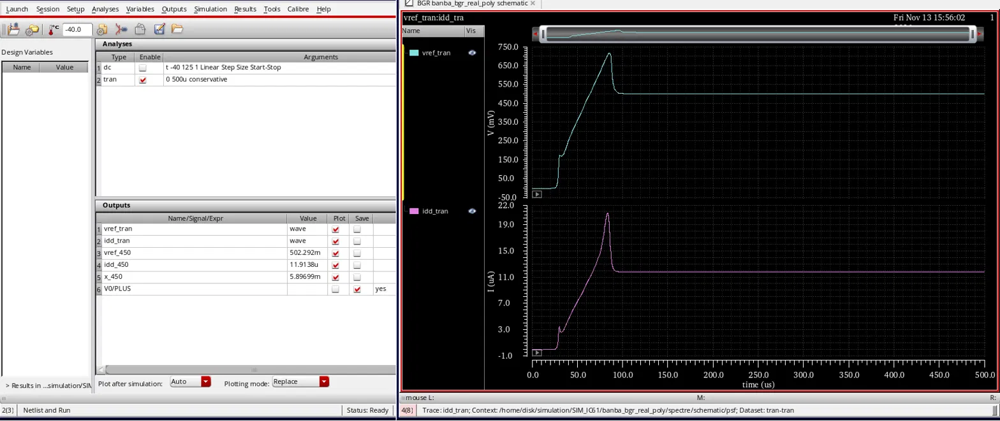 | 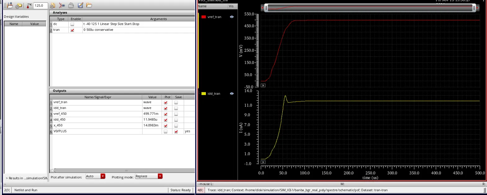 |
| FS | 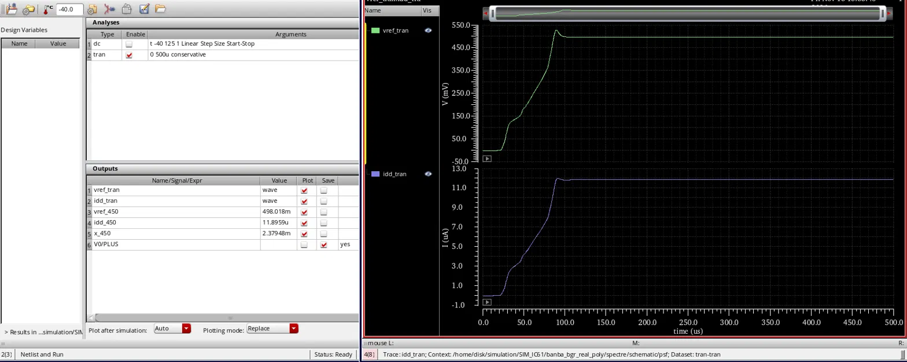 | 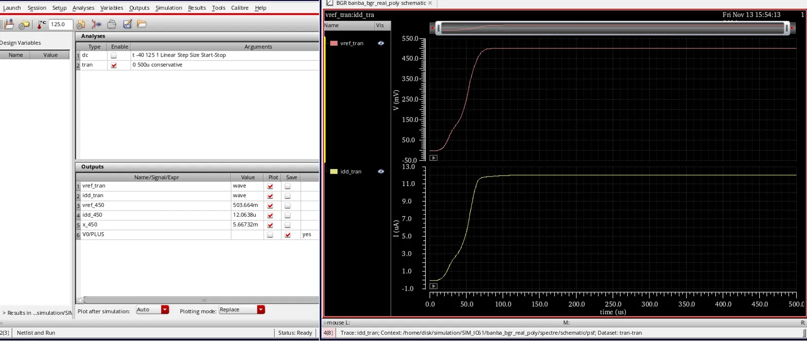 |

The cold waveforms show startup peaks before settling. **No cause for that overshoot has been established**; it is not presented as a diagnosed effect. The screenshots contain ADE output tables for the final values.

### Supply sweep and line regulation

At **27 °C, NN**, the DC supply sweep covered **0.6–1.2 V** in **10 mV** steps. Over the specified **0.9–1.1 V** operating interval, Vref changed by **0.350 mV** across **0.2 V**, giving **1.75 mV/V** line regulation. This **does not meet** the **< 1 mV/V** target. The slopes over **0.9–1.0 V** and **1.0–1.1 V** were **2.72 mV/V** and **0.78 mV/V**, respectively.

The supply current at **0.9 / 1.0 / 1.1 V** was **11.8662 / 11.912 / 11.9607 µA**. The following **single screenshot** covers Vref, supply current and the line-regulation readings; there are no separate current or line-regulation image files.

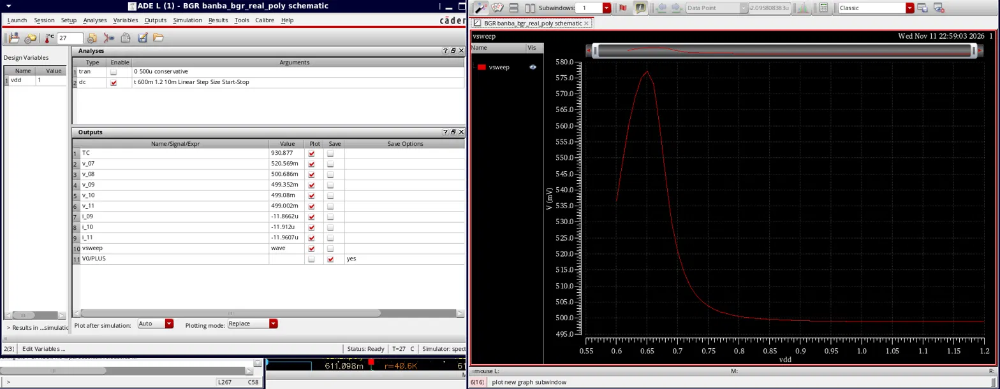

The ADE row `TC = 930.877` comes from a supply-voltage sweep, so it is not a valid temperature coefficient measurement.

### Power-supply rejection

At **27 °C, 1.0 V, NN**, the **AC PSRR** measurement was **57.4149 dB at 10 Hz**, **57.4124 dB at 1 kHz** and **48.8153 dB at 100 kHz**. It stayed above **40 dB** only until **250.693 kHz**; it was **29.0121 dB at 10 MHz**. The unexplained high-frequency bump seen in the plot is **a plot observation, not a diagnosed mechanism**.

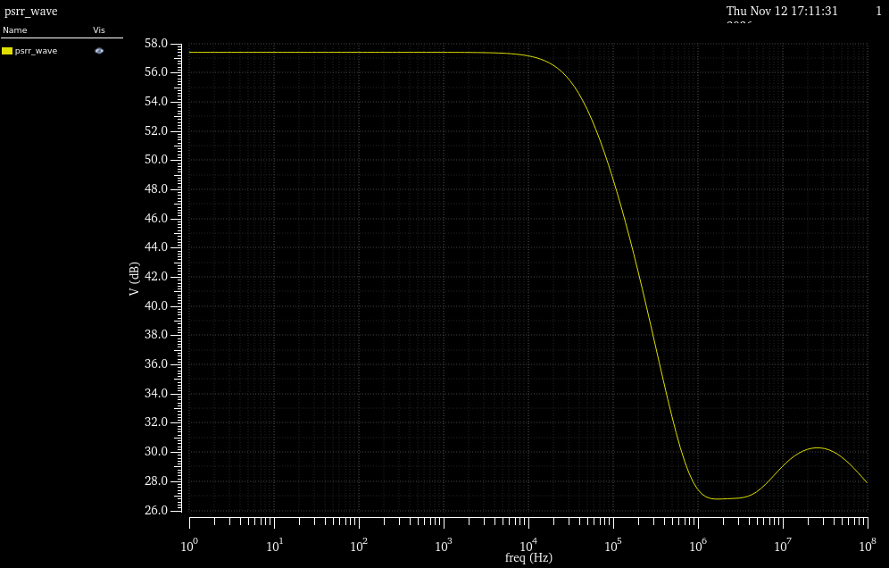

### Loop stability

Spectre `stb` was run at **27 °C, NN**, from **1 Hz to 100 MHz** with **20 points/decade**, using the **IPRB0** probe. The DC loop gain was **46.8765 dB**, the unity-gain frequency **2.00931 MHz**, and the directly read phase was **179.997° at 1 Hz** and **71.8078° at unity gain**. With this loop-gain sign convention, the **phase margin is 71.8°**.

The simulator's raw `pm` row did not correspond to the phase margin for this representation; the margin here is obtained from the phase readings rather than copying that row.

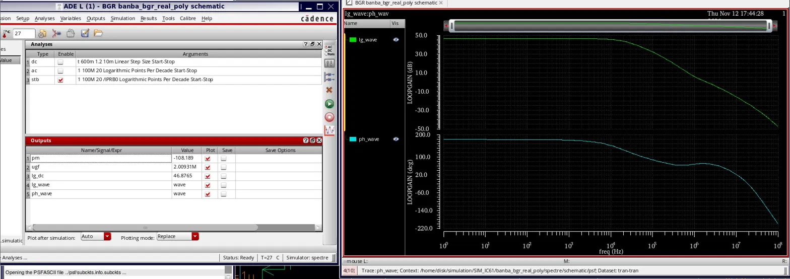

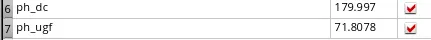

## Design journey: three important debugging lessons

1. **Correct DC output did not prove correct feedback.** With the OTA inputs connected in the wrong polarity, a no-nodeset power-up transient latched near **983 mV**. Swapping the sensing connections made the feedback negative. **Why this mattered:** a plausible DC point alone can hide a startup or loop-polarity failure.
2. **A startup transistor affected temperature accuracy even after startup.** With **NM2 L = 100 nm**, its current at **125 °C** was **201.277 nA**, alongside a large OTA branch offset. Increasing **NM2 L to 1 µm** lowered that current to **9.61338 nA** at **125 °C**. **Why this mattered:** a supposedly inactive device can still leak enough to disturb a sensitive feedback loop. The **rs** value then required retuning.
3. **Resistor scaling reduced power without discarding the reference-voltage idea.** Scaling resistors **1.5×** changed supply current from **19.10447 µA** to **12.91932 µA**, with Vref changing little because the current reductions and output-resistor scaling largely canceled. **Why this mattered:** preserving resistor ratios retains the current-mode design principle while reducing consumption.

More problems, discarded hypotheses and fixes are documented in [the design journey](docs/design_journey.md).

## Limitations and what I would change

**These are pre-layout results only.** No bandgap layout, extracted parasitics or post-layout verification exists. The device models and simulation coverage also limit the conclusions.

- **Line regulation — not met:** **1.75 mV/V** over **0.9–1.1 V**, **27 °C**, NN, versus **< 1 mV/V**. **Hypothesis (untested):** PM3 drives the approximately **0.5 V** output, whereas PM1/PM2 drive nodes around **0.6 V**; the unequal drain–source voltages may make mirror-current error vary with supply. **Untested next ideas:** longer PM1–PM3 channels or a better mirror/cascode, followed by retuning and fresh simulations.
- **FS-corner TC — not met:** **70.30 ppm/°C** versus **< 50 ppm/°C**. **Measured correlation, not a proven cause:** the FS OTA offset at **125 °C** was **−629.245 µV**, versus **−287.635 µV** in NN. **Untested next idea:** investigate offset and the loop operating point across corners before making topology or sizing changes. No FS startup-leakage measurement is available, so startup leakage is **not** claimed as its cause.
- **PSRR bandwidth limitation:** PSRR was above **40 dB only up to 250.693 kHz**. Low-frequency PSRR was **57.4 dB**, but that cannot be described as high-frequency rejection above **40 dB**. **Untested next idea:** investigate the mirror, OTA and compensation paths at higher frequencies before proposing a change.
- **Model simplifications:** startup RS is an **ideal 2 MΩ** resistor; `resnsnpoly` model TC fields are **zero**, so physical resistor temperature drift is not modeled. SF/FS use typical resistors and PNP models. These limitations could matter for practical implementations.
- **Unresolved behavior:** the cold startup overshoot and the high-frequency PSRR bump have not been diagnosed. **Plot readings are not substitutes for measurement markers.**
- **Coverage not completed:** supply sweep, line regulation, PSRR and `stb` were measured at **27 °C NN only**, not at temperature extremes or non-typical corners. No combined **0.9/1.1 V** supply-and-process-corner sweep, **27 °C startup for SS/FF/SF/FS**, noise analysis, trimming, or completed mismatch study is reported.
- **Monte Carlo: planned; pilot run, not completed.**

Future physical implementation would also require a real RS resistor, careful PNP matching/layout, parasitic extraction and new post-layout verification. All proposed changes above are **ideas, not measured improvements**.

## How to reproduce the pre-layout analyses

**Tools:** Cadence Virtuoso, **ADE L**, Spectre, and the **gpdk090 v4.6** model library. The environment used the model file at `/home/work/gpdk090_v4.6/models/spectre/gpdk090.scs`; change this path for a different installation. The provided netlists use the final `banba_bgr_real_poly` schematic and its **IPRB0** loop probe.

- **Model corner:** the provided netlists specify `section=NN`. **To reproduce a corner result, change `section=NN` in the model include line to `SS`, `FF`, `SF` or `FS`.** In ADE L, choose the corresponding section under **Setup > Model Libraries**.
- **Accuracy:** for temperature sweeps, set **Simulation > Options > Analog > `reltol = 1e-6`**. The original default `1e-3` produced avoidable run-to-run changes. The documented final TC runs used **no nodesets**.
- **TC and corners:** DC sweep **Temperature = −40 to 125 °C**, **1 °C** step; supply **1.0 V**. Calculate `(max(Vref) − min(Vref)) / (average(Vref) × 165) × 1e6` in **ppm/°C**.
- **Supply sweep:** set the DC voltage of **V0** to ADE variable `vdd`; copy that variable from the cellview and set its value to **1** before sweeping. Sweep **0.6–1.2 V** in **10 mV** steps at **27 °C, NN**. Without the variable definition, Spectre can report **SFE-1997**.
- **PSRR:** use the DC/AC source `V0 (net23 0) vsource dc=1 mag=1 type=dc`; run AC over **1 Hz–100 MHz** at **27 °C, NN** and evaluate `-dB20(Vref)` with a **1 V** AC input magnitude.
- **Stability:** run `stb` over **1 Hz–100 MHz**, **20 points/decade**, at **27 °C, NN**, selecting **IPRB0** as the loop probe. Read loop-gain phase at **1 Hz** and the unity-gain frequency; use the actual phase readings for phase margin.
- **Startup:** use the pulse-source netlist, with **V1=0 V, V2=1 V, delay=10 µs, rise=100 µs, fall=1 ns, width=1 s, period=2 s, DC=1 V**. Run a **0–500 µs** transient with the desired corner and temperature, **without nodesets**; inspect **Vref, supply current and X (`net033`) at 450 µs**.

The supplied netlist files are the final circuit with different **V0** sources for the relevant analyses. Their saved transient-analysis statements are not standalone AC or `stb` setups: configure those analyses in ADE as above. The saved simulator temperature is also a snapshot; set the temperature explicitly for each reproduction run. Spectre requires a licensed installation and the matching PDK; this repository does not include proprietary model files.

### Why the `IPRB0` probe is kept

**IPRB0 is a zero-volt current probe used for the stb loop-gain analysis. It sits between the OTA output (net22) and the PMOS gate line (net024) and acts as a plain wire in all other analyses.** It is deliberately left in both supplied netlists because **all reported results were simulated with the probe in place**.

The DC/AC/STB netlist has **`mag=1`** on V0 for PSRR; the startup netlist instead uses the documented supply pulse. The two copies preserve the same circuit and `IPRB0`, with their different original generation timestamps.

For the complete ADE Calculator expressions, see [scripts/ade_expressions.md](scripts/ade_expressions.md).

## Repository contents

| Path | Contents |
|---|---|
| `schematics/` | Final top-level, OTA, startup and loop-probe screenshots |
| `netlist/banba_bgr_dc_ac_stb.scs` | Spectre schematic netlist with DC source and AC magnitude |
| `netlist/banba_bgr_startup.scs` | Same circuit with pulse supply for startup transients |
| `results/tc/` | NN, SS, FF, SF, FS DC-temperature results and FS offset screenshot |
| `results/startup/` | Startup transient screenshots for the documented temperature/corner cases |
| `results/supply_sweep/` | Combined Vref, supply-current and line-regulation screenshot |
| `results/psrr/` and `results/stb/` | AC supply rejection and loop-stability screenshots |
| `results/ideal_opamp/` | Earlier ideal-op-amp reference result |
| `docs/results_table.md` | Detailed measured data and pass/fail criteria |
| `docs/design_journey.md` | Investigation trail, failures, causes and fixes |
| `docs/LEARNING_NOTES.md` | Plain-language explanations followed by technical details |
| `scripts/ade_expressions.md` | ADE measurement and Calculator expressions |

**Scope:** demonstrated **pre-layout, schematic-level simulation** only; not a fabricated IC or post-layout characterization.
